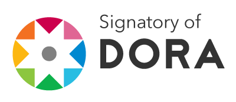

{.light-only}
{.dark-only}
{w=20ex .rounded}

Maître de conférences à La Rochelle Université depuis 1995, j'ai vu mes
intérêts de recherche évoluer du **traitement automatique des langues** vers
l'**analyse formelle de concepts**, en passant par le **traitement d'images**
et la **logique floue**.

Mes travaux actuels portent sur les **enveloppes convexes généralisées** en
analyse formelle de concepts, appliquées à des données complexes et
hétérogènes.

Je suis responsable des enseignements de programmation en langage `C` en
deuxième année de licence informatique à La Rochelle Université.

Ma pratique du judo depuis trois décennies a profondément influencé ma façon
d'enseigner et de mener mes recherches. Je suis particulièrement sensible aux
paroles de [Jigoro Kano](https://fr.wikipedia.org/wiki/Jigor%C5%8D_Kan%C5%8D),
« 自他共栄 — entraide et prospérité mutuelle » et « 精力最活用 — utilisation
optimale de l'énergie ».

~~~{toctree}
:hidden:

blog/index
publications
enseignement
projets
~~~
